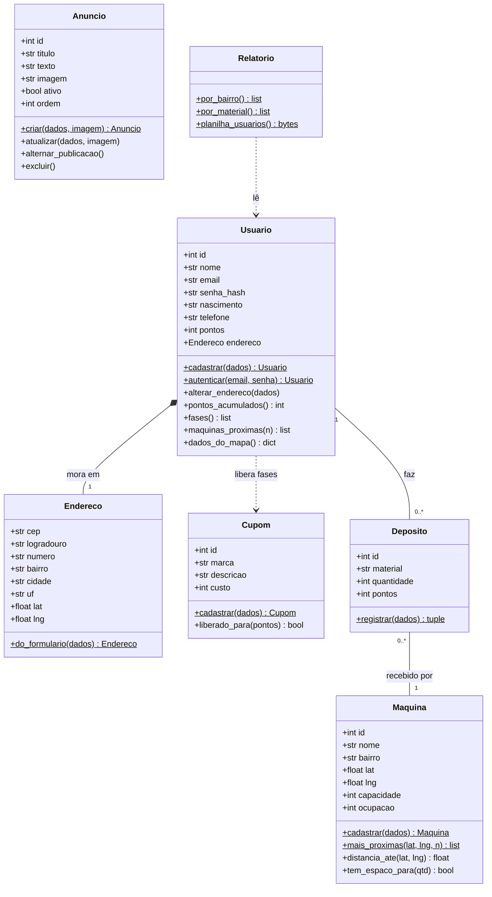

# McCrea MVC: abas Perfil e Admin

Versão simplificada do [McCrea](https://github.com/pbdo888/Projeto-Modelagem) feita para apresentar a
arquitetura **MVC (Model, View, Controller)** no Projeto de Modelagem de Sistemas. Tem só duas abas:

- **Perfil**: criar conta, entrar, ver o painel (pontos, fases de cupons, endereço, **mapa da casa até a
  máquina mais próxima** e a lista das 3 mais próximas), alterar o endereço e sair.
- **Admin** (central do administrador, protegida por token): baixar a planilha de usuários, simular
  depósito, cadastrar cupom e máquina, criar/editar/ocultar/excluir anúncios e ver a reciclagem por bairro
  e por material.

Stack: Python 3.11 + Flask + SQLite. Mapas gratuitos (MapLibre + OpenFreeMap), CEP pelo ViaCEP e
endereço → coordenadas pelo Nominatim. Nenhum deles pede chave.

## Como rodar

**No PyCharm:** abra a pasta `McCreaMVC`, use o interpretador da pasta `.venv` (já criado com as
dependências), abra o `app.py` e clique em ▶ Run. Depois abra http://localhost:5070.

**No terminal:**

```powershell
.venv\Scripts\activate
python app.py
```

Para instalar do zero em outra máquina: `pip install -r requirements.txt` e copie `.env.example` para `.env`.

| O quê | Valor |
|---|---|
| Endereço | http://localhost:5070 (o projeto completo usa a 5050; os dois podem rodar juntos). Não use a 5060: o Chrome e o Firefox bloqueiam essa porta (`ERR_UNSAFE_PORT`) |
| Usuários de exemplo | `ana@exemplo.com`, `bruno@exemplo.com`… `hugo@exemplo.com`, todos com a senha `mccrea` |
| Token do admin | está no arquivo `.env` (`ADMIN_TOKEN`), o mesmo do projeto completo |
| Banco | `mccrea_mvc.db`, criado com os dados de exemplo na primeira execução. Apague o arquivo para recomeçar |

## Como o MVC funciona aqui

```
Navegador ──(1) pedido──> CONTROLLER ──(2) chama──> MODEL ──(3) SQL──> banco SQLite
    ^                         │                       │
    │                         │<──(4) objetos─────────┘
    └──(6) página HTML──── VIEW <──(5) dados──┘
```

| Camada | Pasta | Responsabilidade | Não faz |
|---|---|---|---|
| **Model** | `models/` | Classes do negócio (`Usuario`, `Maquina`…), regras e validações, acesso ao banco | Não conhece HTML nem Flask |
| **View** | `views/` | Templates HTML (Jinja2) que só exibem os dados recebidos | Não acessa o banco nem decide regras |
| **Controller** | `controllers/` | Recebe a requisição, chama os models e escolhe a view | Não guarda regra de negócio |

**Exemplo: alguém clica em "Entrar"** (`POST /perfil/entrar`)

1. `controllers/perfil_controller.py → entrar()` recebe o e-mail e a senha do formulário.
2. Chama o model `Usuario.autenticar(email, senha)` (`models/usuario.py`).
3. O model busca o usuário no banco e confere o hash da senha.
4. Devolve um objeto `Usuario` (ou `None`, se a senha estiver errada).
5. Deu certo: o controller guarda o id na sessão e redireciona para o painel, que renderiza a view
   `views/perfil/painel.html`. Deu errado: mostra de novo `views/perfil/entrar.html` com a mensagem.

Os formulários seguem o padrão **PRG (Post/Redirect/Get)**: depois de um POST certo, o controller
redireciona, e o F5 não reenvia o formulário. Com erro, a mesma view volta com o que já tinha sido digitado.

## Estrutura

```
McCreaMVC/
├── app.py                  monta o app: liga config, models, views e controllers (rode este)
├── config.py               configurações (lê o .env)
├── models/                 M: regras de negócio e banco
│   ├── banco.py            conexão SQLite e criação das tabelas
│   ├── dados_exemplo.py    usuários, máquinas, cupons, depósitos e cartazes de exemplo
│   ├── validacao.py        ErroValidacao e funções de validação reaproveitadas
│   ├── endereco.py         Endereco (objeto de valor, faz parte do Usuario)
│   ├── usuario.py          Usuario: cadastrar, autenticar, alterar endereço, fases, máquinas próximas
│   ├── maquina.py          Maquina e o cálculo de distância
│   ├── cupom.py            Cupom (cada cupom é uma fase)
│   ├── deposito.py         Deposito: credita pontos na máquina mais próxima
│   ├── anuncio.py          Anuncio: CRUD dos cartazes, com envio de imagem
│   └── relatorio.py        Relatorio: análises e a planilha .xlsx
├── controllers/            C: rotas de cada aba
│   ├── autenticacao.py     sessão, @login_obrigatorio e @admin_obrigatorio
│   ├── perfil_controller.py  /perfil/...
│   └── admin_controller.py   /admin/...
├── views/                  V: templates HTML
│   ├── base.html           molde comum (topo, avisos, barra de abas)
│   ├── erro.html
│   ├── perfil/             visitante, entrar, cadastro, endereco, painel, _campos_endereco
│   └── admin/              entrar, painel, anuncio_editar
├── static/                 CSS, imagens, cartazes iniciais e o JavaScript dos mapas
│   └── js/                 mapa.js (marcar casa/máquina) e mapa_perfil.js (casa → máquina mais próxima)
└── tests/                  testes automáticos (pytest, formato AAA)
```

## Diagrama de classes (models)



(`$` = método de classe, chamado sem objeto: `Usuario.cadastrar(...)`.) O PyCharm e o GitHub desenham
este diagrama a partir do bloco `mermaid`.

## Rotas

| Aba | Método | Rota | O que faz |
|---|---|---|---|
| Perfil | GET | `/perfil/` | painel do usuário, com o mapa (ou boas-vindas para visitante) |
| Perfil | GET/POST | `/perfil/entrar` | login |
| Perfil | GET/POST | `/perfil/cadastro` | criar conta |
| Perfil | GET/POST | `/perfil/endereco` | alterar endereço (exige login) |
| Perfil | POST | `/perfil/sair` | sair da conta |
| Admin | GET/POST | `/admin/entrar` | informar o token |
| Admin | POST | `/admin/sair` | sair do modo admin |
| Admin | GET | `/admin/` | central do administrador |
| Admin | GET | `/admin/planilha` | baixar planilha de usuários (.xlsx) |
| Admin | POST | `/admin/depositos` | simular depósito |
| Admin | POST | `/admin/cupons` | novo cupom |
| Admin | POST | `/admin/maquinas` | nova máquina |
| Admin | POST | `/admin/anuncios` | novo anúncio |
| Admin | GET/POST | `/admin/anuncios/<id>/editar` | editar anúncio |
| Admin | POST | `/admin/anuncios/<id>/alternar` | publicar / ocultar |
| Admin | POST | `/admin/anuncios/<id>/excluir` | excluir |

## Regras de negócio (nos models)

- **Cadastro** (`Usuario.cadastrar`): e-mail válido e único, senha com 6+ caracteres e confirmada, idade
  mínima de 13 anos, telefone com DDD, 1 a 30 moradores, endereço completo com posição no mapa e aceite dos
  termos (LGPD). A senha é guardada só como hash.
- **Máquina mais próxima** (`Maquina.mais_proximas`): distância em linha reta a partir do endereço fixo da
  casa, d = √(Δlat² + Δlng²), convertida para km (1° ≈ 111,32 km). Sem GPS em tempo real.
- **Mapa do painel** (`Usuario.dados_do_mapa` + `static/js/mapa_perfil.js`): o model entrega a casa, as máquinas
  ativas e a mais próxima; o JavaScript só desenha o pino azul (casa), os verdes (máquinas) e a linha tracejada
  entre a casa e a mais próxima. É a mesma linha reta do cálculo de distância, não uma rota de ruas.
- **Depósito** (`Deposito.registrar`): PET 10, lata 15, vidro 20 e papel 5 pontos por item; vai para a
  máquina mais próxima da casa e é recusado se ela estiver cheia. Tudo numa transação.
- **Fases** (`Usuario.fases`): cada cupom ativo é uma fase, liberada quando os pontos acumulados chegam ao
  custo dele.
- **Anúncios** (`Anuncio`): imagem PNG, JPG, WebP ou GIF até 5 MB, conferida pelo conteúdo do arquivo.

## Testes

```powershell
.venv\Scripts\python -m pytest
```

40 testes em `tests/` (models, aba Perfil e aba Admin), no formato AAA (Arrange, Act, Assert). Cada teste
usa um banco temporário, então o `mccrea_mvc.db` não é alterado.

## Diferenças em relação ao projeto completo

- Só as abas Perfil e Admin. Ficaram de fora a Home (praça), as Notícias (carrossel) e o mundo de cupons
  animado. No Perfil, as fases aparecem como uma lista simples.
- Páginas montadas no servidor (Flask + Jinja2), com formulários comuns, no lugar da API JSON + JavaScript do
  projeto completo. O JavaScript que sobrou serve só para o mapa e o CEP.
- O depósito simulado escolhe o usuário numa lista (no completo, valia para o usuário logado no mesmo navegador).
- A planilha é gerada na hora do download, sem ficar salva em disco.
- Sem as tabelas de funcionários, coletas e resgates, que essas duas abas não usam.

## Limitações

- Sem recuperação de senha nem limite de tentativas de login.
- O Nominatim aceita 1 consulta por segundo e às vezes acha só a rua; por isso o pino pode ser arrastado
  ou as coordenadas digitadas.
- Proteção contra envio de formulário por outros sites só pelo cookie `SameSite=Lax` (sem token CSRF).
- Dados, bairros e marcas parceiras de exemplo são fictícios.
